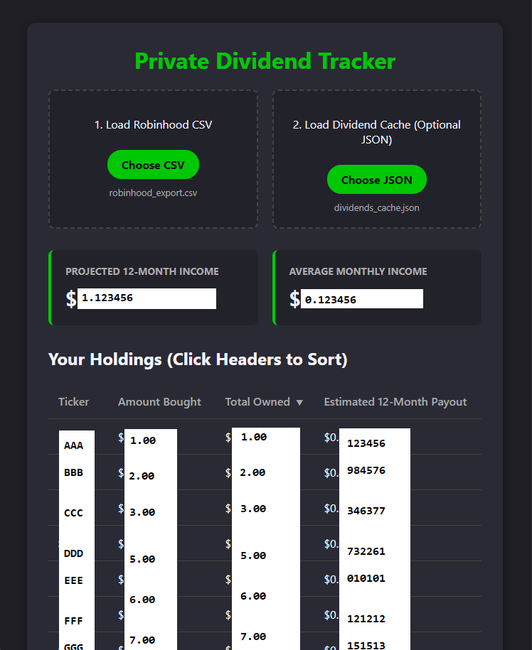

11/5/2026 Initial Release: (Coded with the help of Google Gemini AI LLM)

censored information (The white boxes are from deleting the sections of the image and not on the actual output)

This is a simple app to display your dividends for RobinHood because the limit this information to mobile only and I wanted to be able to view it on a computer with a large screen, but a tiny phone screen with annoying touch screen and annoying navigation issues that come from that.

go to:
<a href="https://robinhood.com/account/reports-statements/activity-reports">https://robinhood.com/account/reports-statements/activity-reports</a>
generate a report from the oldest possible date to todays date, which is about 5 years of history.
This may take hours or a day, so if you want to use this, go ahead and request one be made before you bother with anything else.

For older purchase information you have to go to:
<A href="https://robinhood.com/account/history">https://robinhood.com/account/history</a>
scroll down, let it load and keep repeating this until you reach the start of your account.

There may be a better way to do this, but it is all I know.

You will be able to eventually download a file that looks something like this: "A7FC2-BEA23-6FD2.CSV"

Make a copy of your hexadecimal filename you downloaded that is something like "A7FC2-BEA23-6FD2.CSV"
name the copy of the file to "robinhood_export.csv"

if you have repeated purchases of a few stocks that aren't in the CSV but where in the Purchase History, 
then you can simply edit the value such as:

"1/23/2000","1/23/2000","1/23/2000","NVDA","NVIDIA
CUSIP: 12345A123","Buy","0.012345","$123.45","($1.00)"
You see the number in parenthesis, ($1.00) that is how much you bought.

lets say you had another one also.
"12/23/2000","12/23/2000","12/23/2000","NVDA","NVIDIA
CUSIP: 333333333","Buy","0.033333","$333.33","($12.00)"
You see the number in parenthesis, ($12.00) that is how much you bought.

Now in your CSV file, find one of the buys for NVDA
CUSIP: 11111A111","Buy","0.02222","$222.22","($2.00)"
You see the number in parenthesis, ($2.00) that is how much you bought.

So take the previous ones, the ($1.00) and the ($12.00) and add them to the ($2.00)
1+12+2 = 15 = ($15.00)

so
CUSIP: 11111A111","Buy","0.02222","$222.22","($2.00)"
You see the number in parenthesis, ($2.00) that is how much you bought.
becomes:
CUSIP: 11111A111","Buy","0.02222","$222.22","($15.00)"
You see the number in parenthesis, ($2.00) that is how much you bought.

While this makes your CSV file inaccurate for history, it is the easiest way i think to add the missing amounts.

All you are doing is editing a single value in your copy of the CSV file for each stock you bought that wasn't in the CSV file, but was over 5 years ago, so it was only in your account history.
It's a lot of text to say this, but i wanted it to be easy to follow without questions.

Step 1.
In the "Robinhood-fetch.py" file, open it in a text editor like notepad
You will see these lines near the top.

# pip install yfinance
# (Run the above install a second time in a row, if you get an error)

You need to open a command prompt, for me I have to do it as administrator,
type:
pip install yfinance
as the note says, if you get an error with red text, try running it again, hopefully it doesn't get an error this second time.

Step 2.
After that you see the filenames:

# Update with your actual Robinhood CSV filename
ROBINHOOD_CSV_PATH = "robinhood_export.csv"
CACHE_FILE_PATH = "dividends_cache.json"

in the command prompt run:
py Robinhood-fetch.py
This will take a little while and it will show you the progress in the prompt window.

Step 3.
Once it is done, you will have a file called "dividends_cache.json"

The format will be like this (but that doesn't matter. you can open to verify no problems or not open it.),
{
    "AAA": 1.08,
    "BBB": 6.92,
    "CCC": 2.52,
    "DDD": 6.8,
    "EEE": 0.0,
...
}

Step 4.
Now the hard part is over.
Open the HTML file, 
Click Choose CSV and load the "robinhood_export.csv"
Click Load Dividend Cache and load the "dividends_cache.json"

Now you have an output of the Projected 12 months and projected average monthly income.
This is different from the Robinhood App and the website.
If you just now started buying stocks with dividends in November, you may be confused and worried that the amount is incredibly low.
This is because they are showing you projected annual dividends for the rest of the callander year.

However, my app is showing you an estimate for 12 months, no matter what.

I can't vouch for the accuracy of this data, it seems pretty close to being accurate, but doing my math on my own, it seems like it might be off by a little. For example, in my case, either I am overlooking something or a typo, but my dividend amount seems to be about 6% lower than it should be.
However, I frequently get a number wrong when doing long lists of numbers, and I didn't double check.

So if your life depends on the accuracy of this information, I'm sorry but you shouldn't do that.

it is possible that the website source it gets the dividend information from, does not match Robinhood, which is another thing i suspect.

I will review this information later today or soon and see what the issue is.
I also might be making wrong understanding in calculations.

UPDATE: 1/6/2026 later:
Okay so some of them the "yfinance" responded with 0.00 which i fixed and got it within 2.75% of what I had calculated manually.
I suspect the remaining 2.75% is because of rounding.
Robinhood shows quarterly values like $0.2501 whereas yfinance is giving me yearly, so you multiply quarterly by 4 to get yearly at like $1.00 which means it is losing the $0.0004 and while in this example it's practically nothing, another example could be more significant, especially if you have a ton of stocks, the fractions add up.
